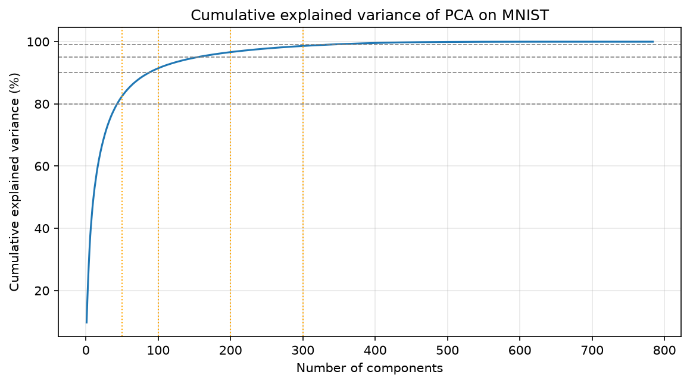
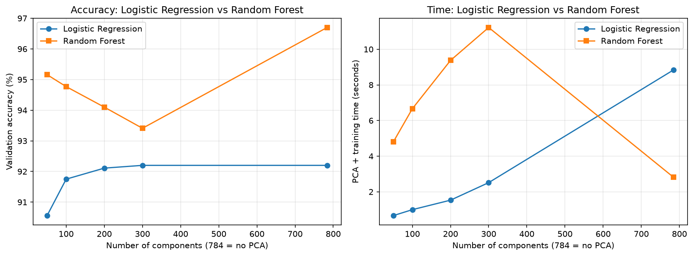

# PCA: Dimensionality Reduction vs. Information Loss on MNIST

Course project for UML501 (Machine Learning Lab), Thapar Institute of Engineering and Technology (Project 10).

I used PCA to reduce the 784 pixel features of MNIST to 300, 200, 100 and 50 components, and measured how this changes accuracy and training time for Logistic Regression and Random Forest.



## Results (test set, 10,000 images)

| Model | Features | Test accuracy | Macro-F1 | PCA + train time |
|---|---|---|---|---|
| Logistic Regression | 784 | 92.58% | 92.47% | 13.1 s |
| Logistic Regression + PCA | 100 | 92.18% | 92.06% | 1.2 s |
| Random Forest | 784 | 96.92% | 96.89% | 4.0 s |

**Key findings**
- 87 components (11% of the features) keep 90% of the variance, and 154 keep 95%.
- For Logistic Regression, PCA with 100 components lost only 0.40 points of accuracy and made training about 11 times faster.
- For Random Forest, PCA lowered accuracy and made training slower, so the original pixels were better.



## Method
- **Data:** MNIST from OpenML (ID 554). Official split: 60,000 train, 10,000 test. 10,000 of the training images were used for validation.
- **Preprocessing:** pixels divided by 255. PCA fitted on training data only.
- **Models:** Logistic Regression (max_iter=1000) and Random Forest (100 trees), seed 42.
- **Metrics:** accuracy, macro-F1, explained variance, PCA/training/prediction time.

## How to run
```bash
python3 -m venv .venv
source .venv/bin/activate
pip install -r requirements.txt jupyter
jupyter notebook pca_mnist.ipynb
```
Run all cells (about 2 minutes on an Apple M3 Mac). MNIST downloads automatically the first time.